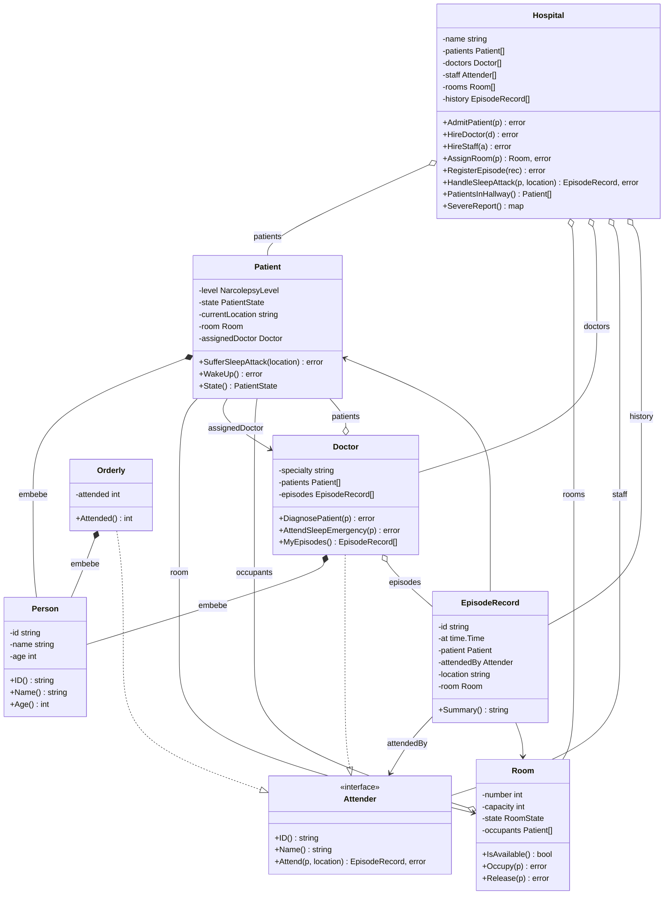

# Hospital de los Costeños con Narcolepsia

Sistema de gestión del Hospital de los Costeños con Narcolepsia, escrito en Go. Modela pacientes que se quedan dormidos de repente en cualquier lugar del hospital, los cuartos con sus camas, los médicos y los camilleros que los atienden y el historial de cada crisis de sueño. El programa principal corre el escenario de demostración del enunciado e imprime las cuatro consultas pedidas.

- **Autor:** Jerónimo Duque Ruiz (trabajo individual)
- **Curso:** Programación Orientada a Objetos, Universidad EIA

## Requisitos

- **Go 1.22 o superior.** El `go.mod` declara `go 1.22`; el enunciado pide como mínimo 1.21.
- El módulo principal usa **solo la librería estándar**: no hay dependencias que descargar.

## Cómo correr

```bash
go run .
```

Corre el escenario obligatorio: crea el hospital con 2 médicos, 1 camillero, 3 cuartos de capacidad 1 y 5 pacientes. Después, 4 pacientes sufren una crisis de sueño: tres reciben cuarto y el cuarto paciente se queda en el pasillo, con el error impreso. Luego un paciente despierta y el del pasillo recibe el cuarto que quedó libre. Al final se imprimen las cuatro consultas.

## Cómo testear

```bash
go test ./...
```

Los tests están en `hospital/hospital_test.go`. Cubren la asignación de cuarto cuando hay uno libre, el fallo cuando no hay ninguno, las cuatro consultas y los casos de error (verificados con `errors.Is`).

## Bonus

- `go run . -sim`: simulación concurrente. (se documenta en las fases 8 y 9)
- `go test -race ./...`: tests con el detector de carreras. (se documenta en las fases 8 y 9)
- `cd gui && go run .`: interfaz gráfica con Fyne. (se documenta en las fases 8 y 9)

## Estructura del proyecto

```
costenos-narcolepsia/
├── go.mod                  módulo costenos-narcolepsia (go 1.22, sin dependencias)
├── main.go                 paquete main: construye el escenario e imprime (sin lógica de negocio)
├── README.md
├── CLAUDE.md               reglas del proyecto para el asistente de IA
├── docs/
│   └── PLAN.md             plan de trabajo por fases y ramas
└── hospital/               paquete con toda la lógica (nunca imprime)
    ├── doc.go              comentario del paquete: explica el modelo
    ├── person.go           Person: identidad (id, name, age) que se embebe
    ├── states.go           PatientState, NarcolepsyLevel y RoomState (iota + String())
    ├── errors.go           errores centinela (ErrNoRoomAvailable, ErrInvalidData, ...)
    ├── attender.go         interfaz Attender
    ├── episode.go          EpisodeRecord: registro inmutable de una crisis
    ├── patient.go          Patient: estado, nivel, ubicación, cuarto y médico asignado
    ├── room.go             Room: camas, ocupantes, Occupy y Release
    ├── doctor.go           Doctor: diagnostica, atiende y guarda sus episodios
    ├── orderly.go          Orderly: camillero; atiende pero no diagnostica
    ├── hospital.go         Hospital: registro, flujo de la crisis y las 4 consultas
    └── hospital_test.go    tests del paquete
```

## Modelo

### Entidades

| Tipo | Qué representa | Campos principales (no exportados) | Métodos principales |
|---|---|---|---|
| `Hospital` | Orquesta todo el sistema | `name`, `patients`, `doctors`, `staff []Attender`, `rooms`, `history`, `next` | `AdmitPatient`, `HireDoctor`, `HireStaff`, `AddRoom`, `AssignRoom`, `RegisterEpisode`, `HandleSleepAttack`, `WakeUpPatient`, `PatientsInHallway`, `SevereReport` |
| `Patient` | Paciente con narcolepsia | `Person` (embebido), `level`, `state`, `currentLocation`, `room`, `assignedDoctor` | `SufferSleepAttack`, `WakeUp`, `State`, `Level`, `Location`, `Room`, `AssignedDoctor` |
| `Doctor` | Médico del hospital | `Person` (embebido), `specialty`, `patients`, `episodes` | `DiagnosePatient`, `AttendSleepEmergency`, `Attend`, `MyEpisodes`, `Patients`, `Specialty` |
| `Room` | Cuarto con capacidad fija | `number`, `capacity`, `state`, `occupants` | `IsAvailable`, `Occupy`, `Release`, `Number`, `Capacity`, `State`, `Occupants` |
| `EpisodeRecord` | Registro de una crisis de sueño | `id`, `at`, `patient`, `attendedBy Attender`, `location`, `room` | `Summary`, `ID`, `At`, `Patient`, `AttendedBy`, `Location`, `Room` |
| `Orderly` | Camillero (segundo tipo de `Attender`) | `Person` (embebido), `attended` | `Attend`, `Attended` |

Todos se crean con su constructor (`NewHospital`, `NewPatient`, `NewDoctor`, `NewRoom`, `NewOrderly`), que valida los datos y retorna `error` si son inválidos (salvo `NewHospital`, que no puede fallar). `EpisodeRecord` no tiene constructor exportado: solo lo crea un `Attender` dentro del paquete.

### Composición: `Person`

`Person` (`id`, `name`, `age`) está **embebido por valor** en `Patient`, `Doctor` y `Orderly`. Sus métodos `ID()`, `Name()` y `Age()` se promueven a esos tipos, así que ningún campo de identidad se repite.

### Interfaz: `Attender`

```go
type Attender interface {
    ID() string
    Name() string
    Attend(p *Patient, location string) (EpisodeRecord, error)
}
```

`*Doctor` y `*Orderly` la implementan (hay una comprobación en tiempo de compilación: `var _ Attender = (*Doctor)(nil)`). El hospital guarda su personal en un `[]Attender` y despacha cada emergencia por turnos, sin type switch ni type assertion. El médico, al atender, diagnostica al paciente si aún no tiene médico. El camillero solo registra el episodio y nunca diagnostica.

### Diagrama



En el diagrama, `Patient[]` significa `[]*Patient` y `SevereReport` retorna `map[*Patient]int`; se simplifican porque mermaid no muestra bien los tipos de Go.

## Decisiones de diseño

1. **Nombres en inglés.** Son consistentes con el enunciado, que da las firmas en inglés, y evitan mezclar idiomas en el código.
2. **El `Hospital` orquesta.** `HandleSleepAttack` encadena todo el flujo de la crisis y `main` solo llama métodos. Así no queda lógica de negocio en `main.go`, como exige el enunciado.
3. **El paciente guarda `room *Room`.** El `EpisodeRecord` copia ese cuarto al crearse (`nil` = se quedó en el pasillo), y al despertar `WakeUpPatient` sabe qué cuarto liberar sin buscarlo.
4. **`Room.Occupy` cambia al paciente con un método no exportado** (`p.moveToBed(r)`), no tocando sus campos, aunque estén en el mismo paquete. Así el cuarto y el paciente siempre quedan de acuerdo. `Doctor.DiagnosePatient` usa la misma idea con `p.assignDoctor(d)`.
5. **En `EpisodeRecord`, quién atendió es de tipo `Attender`**, no `*Doctor`, porque el camillero también atiende emergencias.
6. **`Doctor.Attend` agrega el registro a `d.episodes`.** Por eso `MyEpisodes()` funciona sin recibir el hospital, como pide el enunciado.
7. **El ID del episodio lo genera quien atiende**, con su propio contador (`D-01-E1`, `O-01-E1`). No hay variables globales, que además serían un problema con concurrencia.
8. **Despacho round-robin** sobre el `[]Attender` (`Hospital.dispatch`). Es simple, determinista (el mismo escenario da siempre el mismo resultado) y no necesita saber el tipo concreto.
9. **Errores centinela** en `hospital/errors.go`, envueltos con `fmt.Errorf("...: %w", err)`. Quien llama los distingue con `errors.Is`, y los tests los verifican igual.
10. **`SufferSleepAttack` retorna `error`** (`ErrAlreadyAsleep` si el paciente ya está dormido). El enunciado da firmas mínimas y pide que todo lo que pueda fallar retorne `error`.
11. **`SevereReport` incluye a los Severe con 0 episodios.** El map no tiene orden, así que `main` ordena las claves por ID antes de imprimir para que la salida sea estable.
12. **Getters de lectura en `Hospital`** (`Patients()`, `Doctors()`, `Staff()`, `Rooms()`, `History()`, `FindPatient(id)`, ...). Retornan copias de los slices, así que quien llama no puede modificar el estado interno, y una vista futura puede leer todo sin tocar `hospital/`.
13. **Cuando el paciente del pasillo recibe cuarto más tarde, no se crea un episodio nuevo.** `AssignRoom` solo asigna el cuarto; el episodio original queda como ocurrió (`-> hallway`).
14. **Se respeta el escenario exacto del enunciado.** Por eso el reporte de severidad da conteos bajos (1 episodio por paciente Severe); el ejemplo del PDF es solo ilustrativo.
15. **Fotos y música serán responsabilidad de la vista, no del dominio** (planeado para la Fase 9, aún no implementado). Vivirán en `gui/media` y `gui/data/`, asociadas al paciente por su ID, y `hospital/` no sabrá que existen.
16. **La interfaz Fyne será un módulo Go aparte** (`gui/go.mod`, planeado para la Fase 9, aún no implementado). Así el módulo principal sigue siendo 100 % librería estándar, y la GUI solo puede usar lo que `hospital` exporta.

## Flujo de una crisis de sueño

`Hospital.HandleSleepAttack(p, location)` retorna `(EpisodeRecord, error)`. Estos son sus pasos:

1. **Validación.** Si `p` es `nil`, retorna un error que envuelve `ErrInvalidData`.
2. **El paciente se duerme.** `p.SufferSleepAttack(location)` lo pasa a `AsleepInHallway`, guarda la ubicación y lo deja sin cuarto. Si ya estaba dormido, retorna `ErrAlreadyAsleep` y no se registra nada.
3. **Búsqueda de cuarto.** `h.AssignRoom(p)` recorre los cuartos en el orden en que se agregaron y llama `Occupy` en el primero con cama libre. `Occupy` pasa al paciente a `AsleepInBed` y, si se llenó la última cama, el cuarto pasa a `Occupied`.
   - Si no hay cama libre, el error (`ErrNoRoomAvailable`) se **guarda** en `roomErr` y el flujo **continúa**: el paciente sigue en `AsleepInHallway` y no se inventa ningún cuarto.
   - Cualquier otro error de este paso corta el flujo.
4. **Despacho.** `h.dispatch()` elige el siguiente `Attender` por turnos. Si no hay personal, retorna `ErrNoStaff`.
5. **Atención.** `attender.Attend(p, location)` se llama por la interfaz, sin saber si es médico o camillero:
   - `Doctor`: verifica que el paciente esté dormido, lo diagnostica si no tiene médico asignado, crea el registro y lo guarda en sus `episodes`.
   - `Orderly`: verifica que el paciente esté dormido, crea el registro y aumenta su contador. No diagnostica.
   - El registro toma el cuarto actual del paciente (`nil` si quedó en el pasillo).
6. **Historial.** `h.RegisterEpisode(rec)` agrega el registro al historial del hospital.
7. **Resultado.** Retorna `(rec, roomErr)`. Si `roomErr` envuelve `ErrNoRoomAvailable`, el episodio **sí quedó registrado** y el paciente está en el pasillo; `main` lo detecta con `errors.Is` e imprime el mensaje.

Después, `Hospital.WakeUpPatient(p)` libera la cama del paciente (`Room.Release`, el cuarto vuelve a `Available`) y lo despierta. El paciente del pasillo puede recibir ese cuarto con una nueva llamada a `AssignRoom`.

## Estrategia de Git

Se usa **feature branching** con una rama de integración `dev`:

```
main  ◄── PR solo desde dev (promociones)
  │
dev   ◄── PR de cada rama de trabajo
  │
  ├── feature/...
  ├── test/...
  └── docs/...
```

- **`main`**: versión estable y entregable. Solo recibe Pull Requests desde `dev`.
- **`dev`**: rama de integración. Recibe los Pull Requests de las ramas de trabajo y siempre compila y pasa los tests.
- **Ramas de trabajo**: una por unidad de trabajo, creadas desde `dev` actualizado y devueltas a `dev` por Pull Request.

| Prefijo | Uso | Ejemplo |
|---|---|---|
| `feature/` | funcionalidad nueva | `feature/doctor` |
| `test/` | solo tests | `test/hospital-tests` |
| `docs/` | solo documentación | `docs/readme` |
| `chore/` | setup, formato, mantenimiento | `chore/code-quality` |
| `fix/` | corrección de algo ya integrado | — |

- Todos los Pull Requests se integran con **"Create a merge commit"** (no squash). Así el historial conserva cada commit y muestra de qué rama vino (`Merge pull request #N from ...`).
- Los commits siguen **Conventional Commits**: `feat:`, `fix:`, `test:`, `docs:`, `chore:`, `refactor:`.
- Antes de cada commit se corre: `gofmt -l .` (sin salida), `go vet ./...`, `go build ./...` y `go test ./...`.
