<div align="center">


# Hospital de los Costeños con Narcolepsia

**Sistema de gestión hospitalaria en Go: modelo orientado a objetos con structs, embedding e interfaces, simulación concurrente sin data races e interfaz de escritorio con Fyne.**


Programación Orientada a Objetos · Universidad EIA · 2026-2<br>
**Autor:** Jerónimo Duque Ruiz (trabajo individual)

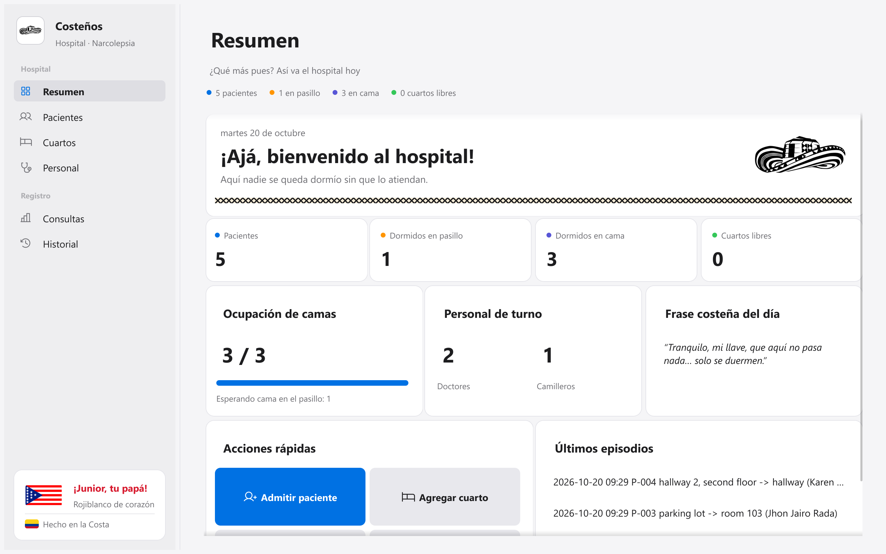

</div>

---

## Contenido

1. [Qué es](#1-qué-es)
2. [Requisitos](#2-requisitos)
3. [Inicio rápido](#3-inicio-rápido)
4. [Cómo correr cada cosa](#4-cómo-correr-cada-cosa)
5. [Arquitectura](#5-arquitectura)
6. [Estructura del proyecto](#6-estructura-del-proyecto)
7. [Modelo de objetos](#7-modelo-de-objetos)
8. [Las cuatro consultas](#8-las-cuatro-consultas)
9. [Flujo de una crisis de sueño](#9-flujo-de-una-crisis-de-sueño)
10. [Manejo de errores](#10-manejo-de-errores)
11. [Bonus: simulación concurrente](#11-bonus-simulación-concurrente)
12. [Bonus: interfaz gráfica con Fyne](#12-bonus-interfaz-gráfica-con-fyne)
13. [Tests](#13-tests)
14. [Decisiones de diseño](#14-decisiones-de-diseño)
15. [Estrategia de Git: feature branching](#15-estrategia-de-git-feature-branching)
16. [Checklist del enunciado](#16-checklist-del-enunciado)
17. [Uso de IA](#17-uso-de-ia)
18. [Créditos y licencias](#18-créditos-y-licencias)

---

## 1. Qué es

Los pacientes del hospital son costeños con narcolepsia: se quedan dormidos de repente en cualquier parte, ya sea en la cafetería, en el parqueadero o en la fila de radiología. El sistema:

- sabe **dónde está cada paciente** y en qué estado (despierto, dormido en el pasillo o dormido en cama);
- registra **cada crisis de sueño** con fecha, lugar, quién la atendió y el cuarto asignado;
- busca **la primera cama libre** y, si no hay ninguna, devuelve un error sin inventar un cuarto (el paciente se queda en el pasillo);
- despacha al **personal** (médicos y camilleros) por turnos, sin saber de qué tipo concreto es cada uno.

El proyecto tiene **tres programas** que usan **el mismo paquete `hospital`** sin modificarlo:

| Programa | Comando | Qué hace |
|---|---|---|
| Escenario obligatorio | `go run .` | Corre el escenario de la sección 6 del enunciado e imprime las 4 consultas |
| Simulación concurrente (bonus +5 %) | `go run . -sim` | Lanza una goroutine por paciente; el hospital está protegido con `sync.Mutex` |
| Interfaz gráfica (bonus +10 %) | `cd gui && go run .` | App de escritorio Fyne para manejar el hospital con botones y formularios |

---

## 2. Requisitos

| Para… | Necesitas | Comprobar con |
|---|---|---|
| Escenario, simulación y tests | **Go 1.22 o superior** (el `go.mod` declara `go 1.22`; el enunciado pide ≥ 1.21) | `go version` |
| `go test -race` y `go run -race` | Go + **gcc** con `CGO_ENABLED=1` (el detector de carreras usa cgo) | `gcc --version` · `go env CGO_ENABLED` |
| Interfaz gráfica | Go + **gcc** con `CGO_ENABLED=1` (Fyne dibuja con OpenGL a través de cgo) | `cd gui && go build .` |

> **Windows:** instala un gcc de 64 bits (por ejemplo [MSYS2](https://www.msys2.org/) con `pacman -S mingw-w64-x86_64-gcc`, o [TDM-GCC](https://jmeubank.github.io/tdm-gcc/)), agrégalo al `PATH` y activa cgo con `go env -w CGO_ENABLED=1`. La guía oficial está en [docs.fyne.io/started](https://docs.fyne.io/started/).
>
> El módulo principal **no descarga nada**: usa solo la librería estándar. Fyne solo se descarga al compilar `gui/`.

---

## 3. Inicio rápido

```bash
git clone https://github.com/DuqueJR/costenos-narcolepsia.git
cd costenos-narcolepsia

go run .            # escenario obligatorio
go test ./...       # tests
```

---

## 4. Cómo correr cada cosa

Todos los comandos se corren desde la raíz del repositorio, salvo los de la GUI.

### 4.1 Escenario obligatorio — `go run .`

Construye el escenario exacto de la sección 6 del enunciado:

1. Crea el hospital, contrata **2 médicos** (Karen Ospina y Luis Carlos Barrios) y **1 camillero** (Jhon Jairo Rada), registra **3 cuartos** de capacidad 1 (101, 102 y 103) y admite **5 pacientes**, dos de ellos `Severe`.
2. **4 pacientes** sufren una crisis de sueño en lugares distintos: tres reciben cuarto y el cuarto paciente (P-004) **se queda en el pasillo**; el error se imprime como un mensaje legible.
3. P-002 **despierta**, libera el cuarto 102 y P-004 **recibe ese cuarto**.
4. Imprime las **cuatro consultas**.

<details>
<summary><b>Ver la salida real del programa</b></summary>

```text
== Hospital de los Costeños con Narcolepsia ==
  2 doctors, 3 staff in total, 3 rooms, 5 patients admitted

== Sleep attacks ==
  2026-10-20 09:25 P-001 cafeteria -> room 101 (Karen Ospina)
  2026-10-20 09:25 P-002 radiology waiting room -> room 102 (Luis Carlos Barrios)
  2026-10-20 09:25 P-003 parking lot -> room 103 (Jhon Jairo Rada)
  2026-10-20 09:25 P-004 hallway 2, second floor -> hallway (Karen Ospina)
  ! P-004  Wilfrido Berrio  could not get a bed and stays in the hallway (assign room to P-004: no room available)

== Patients asleep in hallway ==
  P-004  Wilfrido Berrio  (hallway 2, second floor)

== P-002 wakes up ==
  P-002  Yeimy Padilla    woke up and released room 102
  P-004  Wilfrido Berrio  -> room 102

== Patients asleep in hallway ==
  (none)

== Episodes attended by Dr. Karen Ospina (Neurology) ==
  2026-10-20 09:25 P-001 cafeteria -> room 101 (Karen Ospina)
  2026-10-20 09:25 P-004 hallway 2, second floor -> hallway (Karen Ospina)

== Episodes attended by Dr. Luis Carlos Barrios (Sleep Medicine) ==
  2026-10-20 09:25 P-002 radiology waiting room -> room 102 (Luis Carlos Barrios)

== Room assignment ==
  P-004  Wilfrido Berrio  first attempt:  assign room to P-004: no room available
  P-004  Wilfrido Berrio  second attempt: room 102

== Severity report (Severe patients) ==
  P-002  Yeimy Padilla    1 episode(s) today
  P-004  Wilfrido Berrio  1 episode(s) today
```

La fecha y la hora cambian con cada ejecución. Se nota el despacho por turnos: Karen → Luis → Jhon → Karen.

</details>

### 4.2 Tests — `go test ./...`

```bash
go test ./...               # todos los tests
go test -v ./hospital/      # con el nombre de cada test
go test -cover ./hospital/  # con porcentaje de cobertura
```

### 4.3 Detector de carreras — `go test -race ./...`

```bash
go test -race ./...
```

Incluye `TestConcurrentSleepAttacks` y `TestSimulate`, que ponen varias goroutines a trabajar sobre el mismo hospital. Necesita gcc y cgo (ver [Requisitos](#2-requisitos)).

### 4.4 Simulación concurrente — `go run . -sim`

```bash
go run . -sim          # simulación
go run -race . -sim    # la misma simulación con el detector de carreras (debe terminar sin "WARNING: DATA RACE")
```

Arma el mismo hospital del escenario y lanza **una goroutine por paciente**. Cada una hace 3 rondas de "esperar un tiempo aleatorio (hasta 50 ms) → crisis de sueño en un lugar aleatorio → esperar → despertar". Al final imprime los contadores y las cuatro consultas. El resultado cambia en cada ejecución, porque depende de cómo se intercalan las goroutines:

```text
== Concurrent simulation ==
  5 patients x 3 rounds, random pauses up to 50ms
  attacks: 15, without room: 1, errors: 0
```

### 4.5 Interfaz gráfica — `cd gui && go run .`

```bash
cd gui
go run .        # la primera compilación tarda varios minutos: compila la parte gráfica con gcc
```

Abre una ventana de 1280×800 con el hospital del escenario ya cargado (los mismos médicos, cuartos y pacientes de `main.go`, todos despiertos). Desde ahí puedes provocar crisis, despertar pacientes, asignar cuartos, admitir pacientes, contratar personal y ver las cuatro consultas. Ver la [sección 12](#12-bonus-interfaz-gráfica-con-fyne).

```bash
cd gui
go build ./... && go vet ./...   # compilar y revisar la GUI sin abrirla
```

### 4.6 Calidad del código (definición de terminado)

Antes de cada commit se corrió:

```bash
gofmt -l .        # no debe listar nada
go vet ./...      # sin advertencias
go build ./...    # compila
go test ./...     # pasa
```

### 4.7 Comprobar que la GUI no tocó la lógica

El enunciado premia que el paquete `hospital` **no cambie** al agregar la interfaz. Se comprueba con Git:

```bash
# Commits que tocaron hospital/ o el go.mod raíz: ninguno es de las ramas de la GUI
git log --oneline -- hospital/ go.mod go.sum

# Diferencias en hospital/ y go.mod desde que se integró el último cambio de la lógica
# (merge del PR #17) hasta hoy: vacío
git diff c177e43 HEAD --stat -- hospital/ go.mod go.sum
```

---

## 5. Arquitectura

El repositorio tiene **dos módulos Go**. El principal usa solo la librería estándar; la GUI vive en un módulo aparte, que es el único con dependencias de terceros.

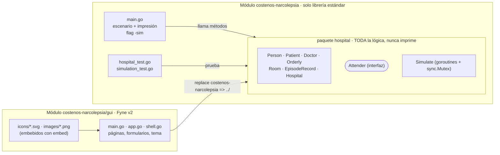

- `main.go` **solo construye el escenario e imprime**; no tiene lógica de negocio.
- `hospital/` **nunca imprime** (no hay `fmt.Print*` en el paquete): retorna datos y errores.
- `gui/go.mod` importa el paquete local con `replace costenos-narcolepsia => ../`. Así Fyne aparece **solo** en `gui/go.mod`, y la GUI únicamente puede usar lo que `hospital` exporta.

---

## 6. Estructura del proyecto

```
costenos-narcolepsia/
├── go.mod                    módulo costenos-narcolepsia (go 1.22, sin dependencias)
├── main.go                   escenario obligatorio y simulación (-sim): construye e imprime
├── README.md
├── CLAUDE.md                 reglas del proyecto para el asistente de IA
├── docs/
│   ├── PLAN.md               plan de trabajo por fases y ramas
│   └── img/gui/              capturas de la interfaz usadas en este README
├── hospital/                 paquete con toda la lógica (nunca imprime)
│   ├── doc.go                comentario del paquete: explica el modelo
│   ├── person.go             Person: identidad (id, name, age) que se embebe
│   ├── states.go             PatientState, NarcolepsyLevel y RoomState (iota + String())
│   ├── errors.go             errores centinela (ErrNoRoomAvailable, ErrInvalidData, ...)
│   ├── attender.go           interfaz Attender
│   ├── episode.go            EpisodeRecord: registro inmutable de una crisis
│   ├── patient.go            Patient: estado, nivel, ubicación, cuarto y médico asignado
│   ├── room.go               Room: camas, ocupantes, Occupy y Release
│   ├── doctor.go             Doctor: diagnostica, atiende y guarda sus episodios
│   ├── orderly.go            Orderly: camillero; atiende pero no diagnostica
│   ├── hospital.go           Hospital: registro, flujo de la crisis, consultas y sync.Mutex
│   ├── simulation.go         Simulate: una goroutine por paciente (bonus)
│   ├── hospital_test.go      tests del modelo, el flujo y las consultas
│   └── simulation_test.go    tests de la simulación
└── gui/                      módulo aparte: interfaz Fyne (bonus)
    ├── go.mod / go.sum       Fyne v2 + replace costenos-narcolepsia => ../
    ├── main.go               crea la app, la ventana y las páginas
    ├── seed.go               hospital inicial (mismos datos que main.go, sin crisis)
    ├── app.go                App: estado compartido, refreshAll, diálogos y avisos
    ├── shell.go              menú lateral, encabezado con contadores y navegación
    ├── dashboard.go          página Resumen
    ├── patients.go           página Pacientes: búsqueda, detalle y acciones
    ├── rooms.go              página Cuartos
    ├── staff.go              página Personal
    ├── queries.go            página Consultas: las 4 consultas del enunciado
    ├── history.go            página Historial
    ├── forms.go              formularios: admitir, contratar, agregar cuarto
    ├── widgets.go            piezas visuales reutilizables (tarjetas, pills, avatar...)
    ├── theme.go              tema claro, colores por estado y textos en español
    ├── motion.go             animaciones con resorte y notificaciones (toasts)
    ├── costa.go              detalles costeños: sombrero, banderas, frase del día
    ├── icons.go              carga los íconos y fotos embebidos (embed)
    ├── icons/                íconos SVG de Phosphor Icons (MIT)
    └── images/               sombrero vueltiao y bandera de Junior (Wikimedia Commons)
```

---

## 7. Modelo de objetos

Go no tiene clases ni herencia. El modelo usa los mecanismos que pide el enunciado: **structs con campos no exportados**, **métodos con receiver**, **composición por embedding** e **interfaces**.

### 7.1 Entidades

| Tipo | Qué representa | Campos principales (no exportados) | Métodos principales |
|---|---|---|---|
| `Hospital` | Orquesta todo el sistema | `mu`, `name`, `patients`, `doctors`, `staff []Attender`, `rooms`, `history`, `next` | `AdmitPatient`, `HireDoctor`, `HireStaff`, `AddRoom`, `AssignRoom`, `RegisterEpisode`, `HandleSleepAttack`, `WakeUpPatient`, `PatientsInHallway`, `SevereReport`, `Simulate` |
| `Patient` | Paciente con narcolepsia | `Person` (embebido), `level`, `state`, `currentLocation`, `room`, `assignedDoctor` | `SufferSleepAttack`, `WakeUp`, `State`, `Level`, `Location`, `Room`, `AssignedDoctor` |
| `Doctor` | Médico | `Person` (embebido), `specialty`, `patients`, `episodes` | `DiagnosePatient`, `AttendSleepEmergency`, `Attend`, `MyEpisodes`, `Patients`, `Specialty` |
| `Room` | Cuarto con capacidad fija | `number`, `capacity`, `state`, `occupants` | `IsAvailable`, `Occupy`, `Release`, `Number`, `Capacity`, `State`, `Occupants` |
| `EpisodeRecord` | Registro de una crisis de sueño | `id`, `at`, `patient`, `attendedBy Attender`, `location`, `room` | `Summary`, `ID`, `At`, `Patient`, `AttendedBy`, `Location`, `Room` |
| `Orderly` | Camillero (segundo tipo de `Attender`) | `Person` (embebido), `attended` | `Attend`, `Attended` |

Todos se crean con su constructor (`NewHospital`, `NewPatient`, `NewDoctor`, `NewRoom`, `NewOrderly`), que valida los datos y retorna `error` si son inválidos (salvo `NewHospital`, que no puede fallar). `EpisodeRecord` no tiene constructor exportado: solo lo crea un `Attender` dentro del paquete.

### 7.2 Composición: `Person`

`Person` (`id`, `name`, `age`) está **embebido por valor** en `Patient`, `Doctor` y `Orderly`. Sus métodos `ID()`, `Name()` y `Age()` se **promueven** a esos tipos, así que ningún campo de identidad se repite.

```go
type Patient struct {
    Person          // embebido por valor: p.ID(), p.Name(), p.Age()
    level           NarcolepsyLevel
    state           PatientState
    currentLocation string
    room            *Room
    assignedDoctor  *Doctor
}
```

### 7.3 Interfaz: `Attender`

```go
type Attender interface {
    ID() string
    Name() string
    Attend(p *Patient, location string) (EpisodeRecord, error)
}
```

`*Doctor` y `*Orderly` la implementan; hay una comprobación en tiempo de compilación (`var _ Attender = (*Doctor)(nil)`). `ID()` y `Name()` vienen de `Person` por embedding. El hospital guarda su personal en un **`[]Attender`** y despacha cada emergencia por turnos (round-robin), **sin type switch ni type assertion**:

- **`Doctor.Attend`**: verifica que el paciente esté dormido, lo **diagnostica** si aún no tiene médico, crea el registro y lo guarda en sus `episodes`.
- **`Orderly.Attend`**: verifica que el paciente esté dormido, crea el registro y aumenta su contador. **No diagnostica.**

### 7.4 Estados como constantes tipadas

Los tres estados son tipos con `iota` y un método `String()`. Nunca se comparan strings sueltos.

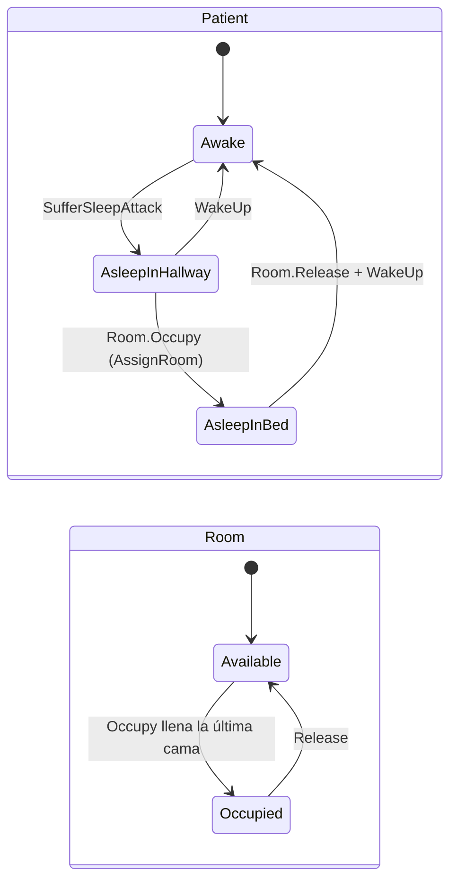

`NarcolepsyLevel` tiene los valores `Mild`, `Moderate` y `Severe`.

### 7.5 Diagrama de clases

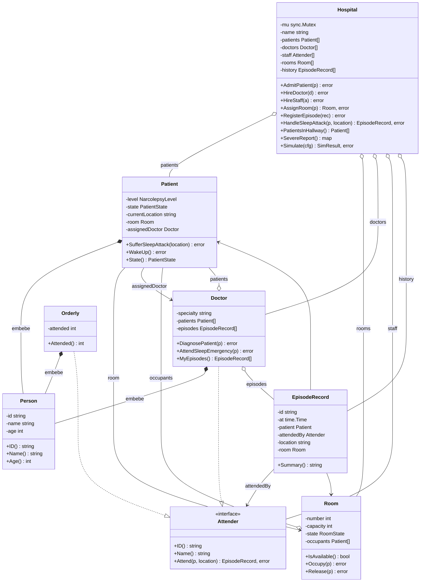

En el diagrama, `Patient[]` significa `[]*Patient` y `SevereReport` retorna `map[*Patient]int`; se simplifica porque Mermaid no muestra bien los tipos de Go.

---

## 8. Las cuatro consultas

Cada consulta es un **método que retorna datos**; nunca imprime. `main.go` y la GUI las llaman y deciden cómo mostrarlas.

| # | Consulta | Firma exacta | Qué retorna |
|---|---|---|---|
| 5.1 | Pacientes dormidos en el pasillo | `func (h *Hospital) PatientsInHallway() []*Patient` | Los pacientes en `AsleepInHallway`, en orden de admisión (slice vacío, nunca `nil`, si no hay) |
| 5.2 | Historial por médico | `func (d *Doctor) MyEpisodes() []EpisodeRecord` | Una copia de los episodios que atendió ese médico; **no recibe el hospital**: la relación vive en `Doctor` |
| 5.3 | Disponibilidad de camas | `func (h *Hospital) AssignRoom(p *Patient) (*Room, error)` | El primer cuarto con cama libre (pasa a `Occupied` si se llena, y el paciente a `AsleepInBed`), o un error que envuelve `ErrNoRoomAvailable` (el paciente sigue en el pasillo y **no se inventa un cuarto**) |
| 5.4 | Reporte de severidad | `func (h *Hospital) SevereReport() map[*Patient]int` | Cada paciente `Severe` → número de episodios **de hoy** (incluye a los que tienen 0) |

Como un `map` de Go no tiene orden, `main.go` y la GUI **ordenan las claves por ID** antes de mostrar el reporte, para que la salida sea estable.

---

## 9. Flujo de una crisis de sueño

`Hospital.HandleSleepAttack(p, location)` encadena todo el flujo **con el mutex tomado de principio a fin**, así que ninguna otra goroutine ve el estado a medias.

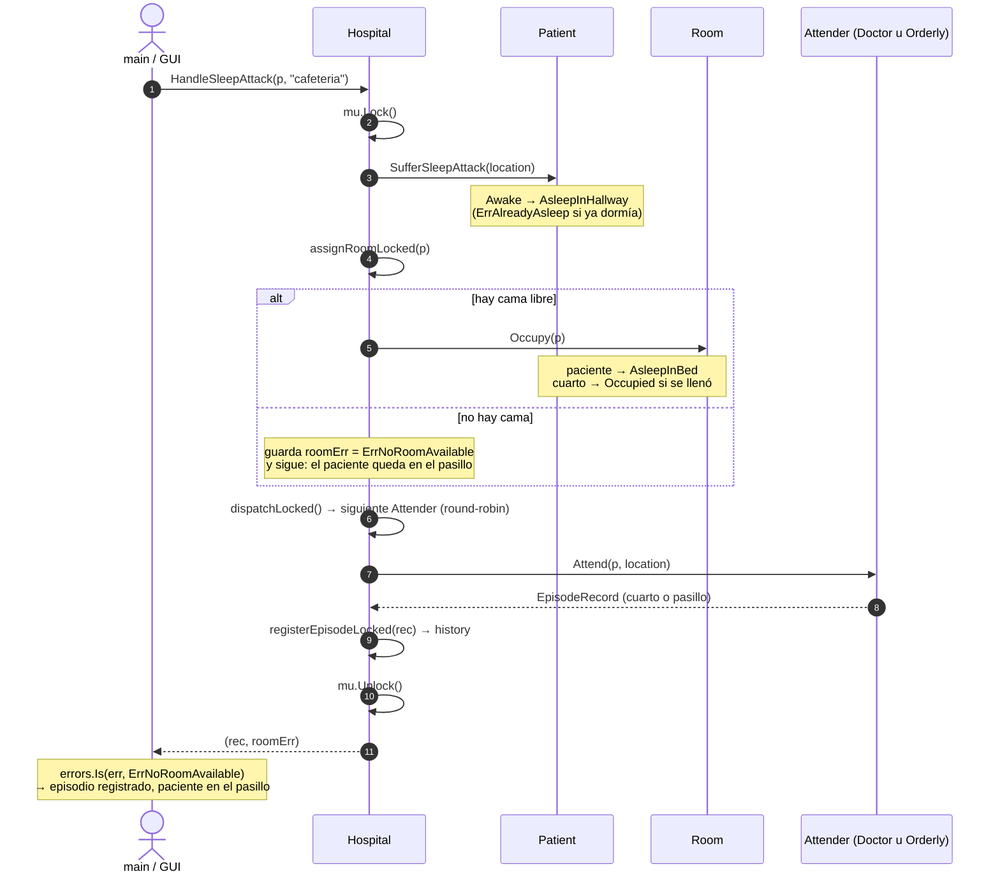

1. **Validación.** Si `p` es `nil`, retorna un error que envuelve `ErrInvalidData`.
2. **El paciente se duerme.** `p.SufferSleepAttack(location)` lo pasa a `AsleepInHallway`. Si ya estaba dormido, retorna `ErrAlreadyAsleep` y no se registra nada.
3. **Búsqueda de cuarto.** Recorre los cuartos en el orden en que se agregaron y ocupa el primero con cama libre. Si no hay, el error `ErrNoRoomAvailable` se **guarda** y el flujo **continúa**; cualquier otro error corta el flujo.
4. **Despacho.** Elige el siguiente `Attender` por turnos. Si no hay personal, retorna `ErrNoStaff`.
5. **Atención.** `attender.Attend(p, location)` se llama **por la interfaz**, sin saber si es médico o camillero.
6. **Historial.** El registro se agrega al historial del hospital.
7. **Resultado.** Retorna `(rec, roomErr)`: si `roomErr` envuelve `ErrNoRoomAvailable`, el episodio **sí quedó registrado** y el paciente está en el pasillo.

Después, `Hospital.WakeUpPatient(p)` libera la cama (`Room.Release`, el cuarto vuelve a `Available`) y despierta al paciente. El paciente del pasillo puede recibir ese cuarto con una nueva llamada a `AssignRoom`.

---

## 10. Manejo de errores

- Todo método que puede fallar retorna **`error` como último valor**. No hay `panic` para situaciones previsibles.
- Los errores son **centinelas** definidos en [`hospital/errors.go`](hospital/errors.go) y se envuelven con contexto usando `fmt.Errorf("...: %w", err)`. Quien llama los distingue con **`errors.Is`**, y los tests los verifican igual.

| Error | Cuándo ocurre |
|---|---|
| `ErrInvalidData` | Un constructor o método recibe datos inválidos (ID vacío, edad negativa, `nil`, configuración de simulación inválida...) |
| `ErrAlreadyAsleep` | Una crisis le da a un paciente que ya está dormido |
| `ErrAlreadyAwake` | Se despierta a un paciente que ya está despierto |
| `ErrRoomFull` | Un paciente intenta ocupar un cuarto sin camas libres |
| `ErrAlreadyInRoom` | Un paciente intenta ocupar un cuarto en el que ya está |
| `ErrNotInRoom` | Se libera a un paciente que no está en ese cuarto |
| `ErrAlreadyUnderCare` | Un médico diagnostica a un paciente que ya tiene médico |
| `ErrPatientAwake` | Alguien intenta atender una crisis de un paciente despierto |
| `ErrDuplicateID` | Se registra un paciente, miembro del personal o cuarto con un ID que ya existe |
| `ErrNotFound` | Se busca un paciente, médico o cuarto que no existe |
| `ErrNotInHallway` | Se intenta asignar cuarto a un paciente que no está dormido en el pasillo |
| `ErrNoRoomAvailable` | No hay ninguna cama libre en el hospital |
| `ErrNoStaff` | Hay que despachar a alguien y el hospital no tiene personal |

---

## 11. Bonus: simulación concurrente

**Requisito del enunciado:** cada paciente es una goroutine que se duerme en intervalos aleatorios, el estado del hospital está protegido con un `sync.Mutex` y todo corre limpio con `go run -race .`.

### Cómo está protegido el hospital

- `Hospital` tiene un campo `mu sync.Mutex` que protege todos sus datos y los pacientes, cuartos y personal que le pertenecen.
- **Convención de bloqueo:** cada método exportado hace `h.mu.Lock()` y `defer h.mu.Unlock()`. Como `sync.Mutex` **no es reentrante**, la lógica vive en helpers no exportados con sufijo `Locked` (`assignRoomLocked`, `dispatchLocked`, `registerEpisodeLocked`, ...), que asumen el lock ya tomado y nunca lo vuelven a pedir. Así `HandleSleepAttack` puede reutilizar la asignación de cuartos sin bloquearse a sí mismo.
- Los getters (`Patients()`, `Rooms()`, `History()`, ...) retornan **copias** de los slices, así que quien llama no puede modificar el estado interno por fuera del mutex.

### Qué pasa si dos goroutines asignan el mismo cuarto a la vez

La segunda **espera** el mutex. Cuando entra, ve el cuarto ya ocupado y busca otro o recibe `ErrNoRoomAvailable`. Sin el mutex habría una *data race*: las dos verían `IsAvailable() == true` y el cuarto terminaría con dos ocupantes. `TestConcurrentSleepAttacks` lo comprueba con `-race`.

### `Simulate`

`func (h *Hospital) Simulate(cfg SimConfig) (SimResult, error)` lanza una goroutine por paciente y espera a todas con `sync.WaitGroup`. Los contadores del resultado son `atomic.Int64`, porque varias goroutines los incrementan a la vez. `Simulate` nunca toma el mutex: las goroutines solo usan los métodos exportados, que lo toman ellas mismas.

> La GUI **no** ejecuta `Simulate`: si las goroutines modificaran pacientes mientras la interfaz lee sus getters habría carreras. Simulación e interfaz son programas separados.

---

## 12. Bonus: interfaz gráfica con Fyne

App de escritorio nativa hecha con [Fyne v2](https://fyne.io), escrita 100 % en Go: sin HTML, JavaScript ni API REST.

### Separación lógica / vista

- `gui/` es **otro módulo Go** (`gui/go.mod`) que importa `costenos-narcolepsia/hospital` con `replace costenos-narcolepsia => ../`. Fyne aparece **solo** en `gui/go.mod`; el `go.mod` raíz sigue sin dependencias.
- **`hospital/` no cambió** con la interfaz (ver [4.7](#47-comprobar-que-la-gui-no-tocó-la-lógica)). La GUI llama exactamente los mismos métodos que `main.go`: `HandleSleepAttack`, `WakeUpPatient`, `AssignRoom`, `PatientsInHallway`, `MyEpisodes`, `SevereReport`, `History`, ...
- Las traducciones al español y los colores de cada estado (`stateLabel`, `stateColor`, ...) viven en `gui/theme.go`. El dominio conserva sus `String()` en inglés para la consola.
- Flujo de cada acción: **botón → callback → método de `Hospital` → `App.refreshAll()`**, que vuelve a leer el hospital y redibuja todas las páginas. Cada página registra su función de refresco al construirse (`addRefresher`).
- Los widgets solo se tocan en el hilo de la interfaz. El único trabajo en otra goroutine es el temporizador que oculta las notificaciones (`time.AfterFunc`), y ese usa `fyne.Do(...)` para volver al hilo de la UI.

### Páginas

| | |
|:---:|:---:|
| <br>**Resumen**: contadores, ocupación de camas, personal de turno, frase costeña del día, acciones rápidas y últimos episodios. | 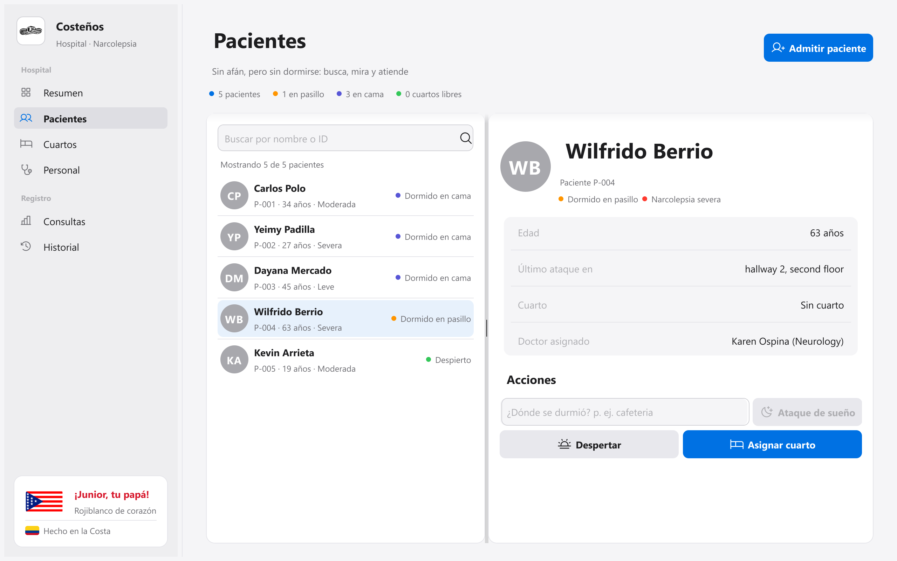<br>**Pacientes**: lista con búsqueda por nombre o ID y estado con color; el detalle habilita solo las acciones válidas (*Ataque de sueño*, *Despertar*, *Asignar cuarto*). |
| 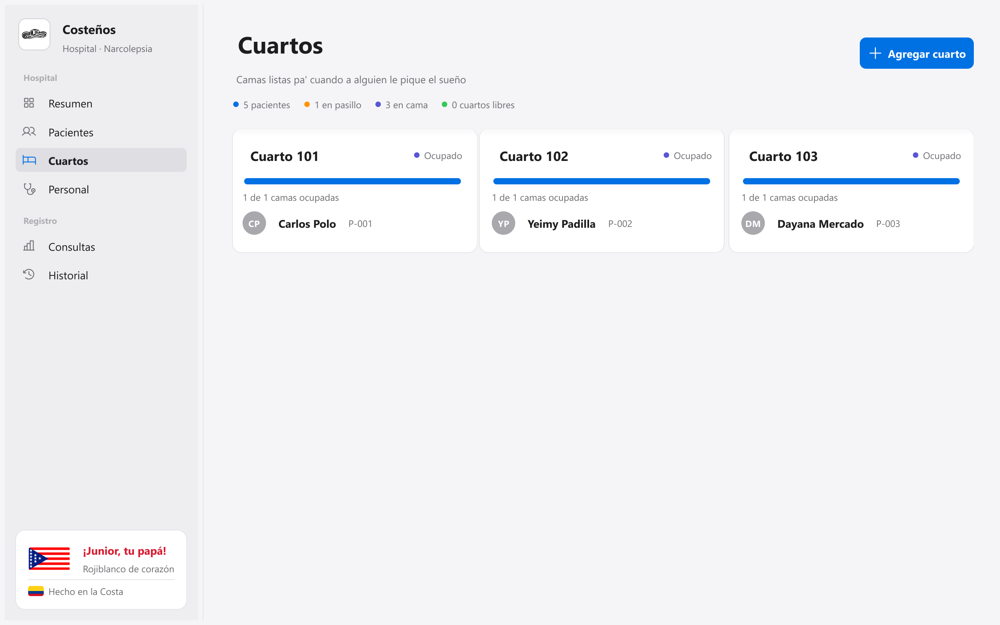<br>**Cuartos**: una tarjeta por cuarto con su estado, barra de camas ocupadas y ocupantes; botón *Agregar cuarto*. | 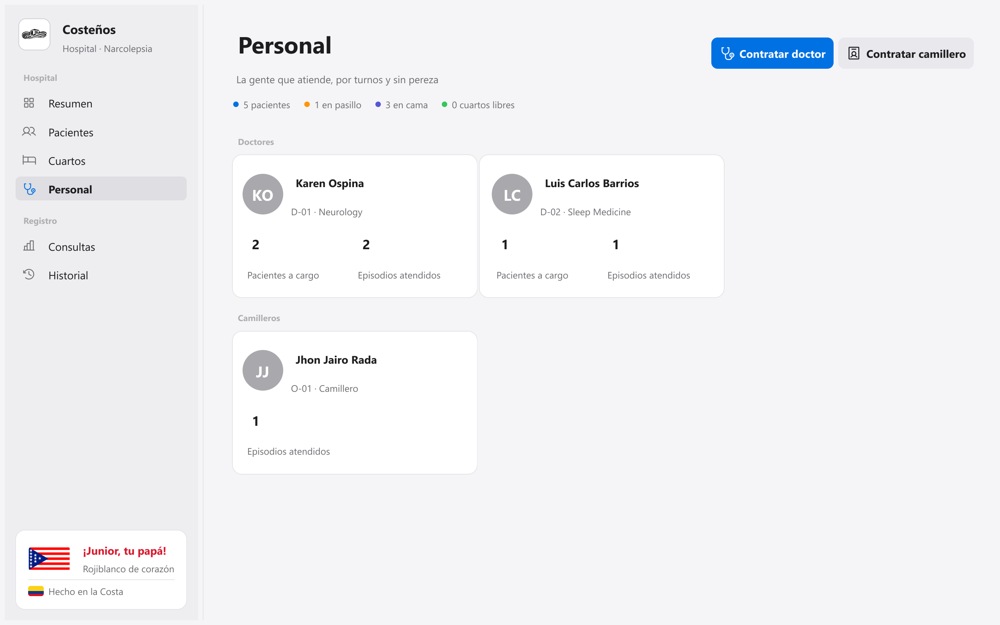<br>**Personal**: médicos y camilleros con sus pacientes a cargo y episodios atendidos; botones para contratar. |
| 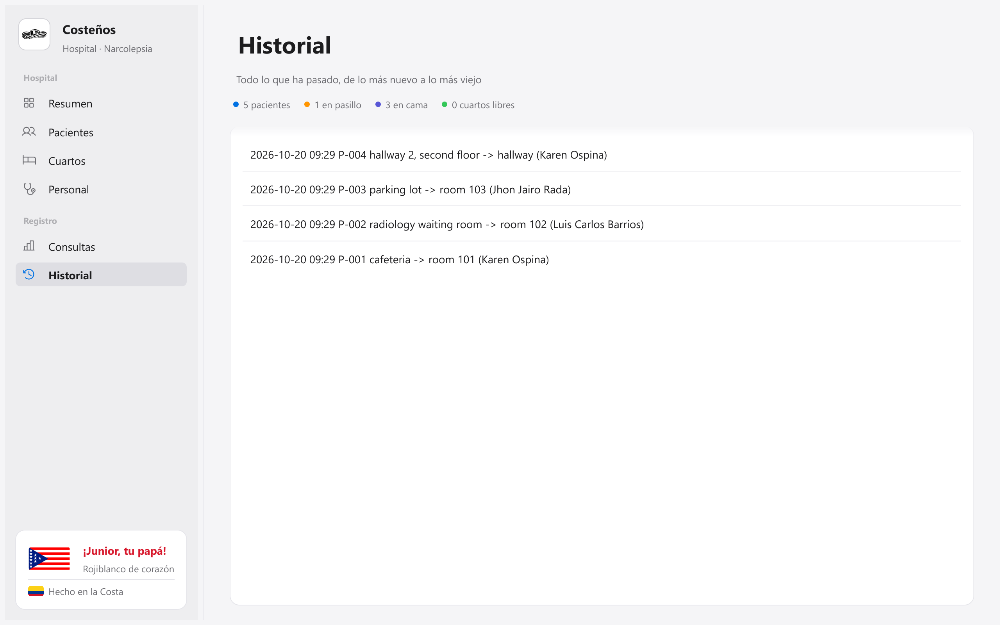<br>**Historial**: todos los episodios con `Summary()`, del más reciente al más antiguo. | 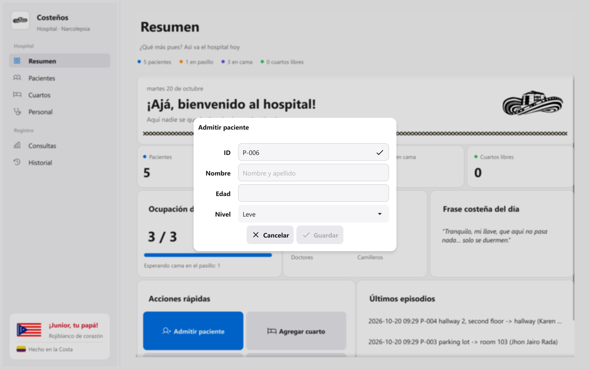<br>**Formularios**: admitir paciente, contratar médico o camillero y agregar cuarto. Proponen el siguiente ID libre y validan antes de guardar; el dominio vuelve a validar con sus constructores. |

### Las cuatro consultas en la GUI

La página **Consultas** muestra cada consulta del enunciado en un control segmentado:

| | |
|:---:|:---:|
| 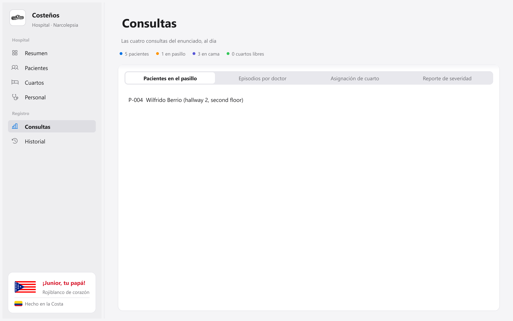<br>**Pacientes en el pasillo** → `PatientsInHallway()` | 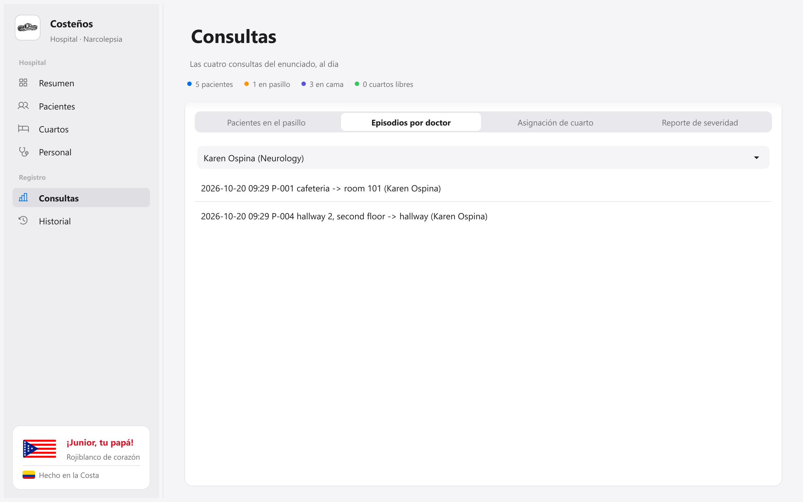<br>**Episodios por doctor** → `MyEpisodes()` del médico elegido |
| 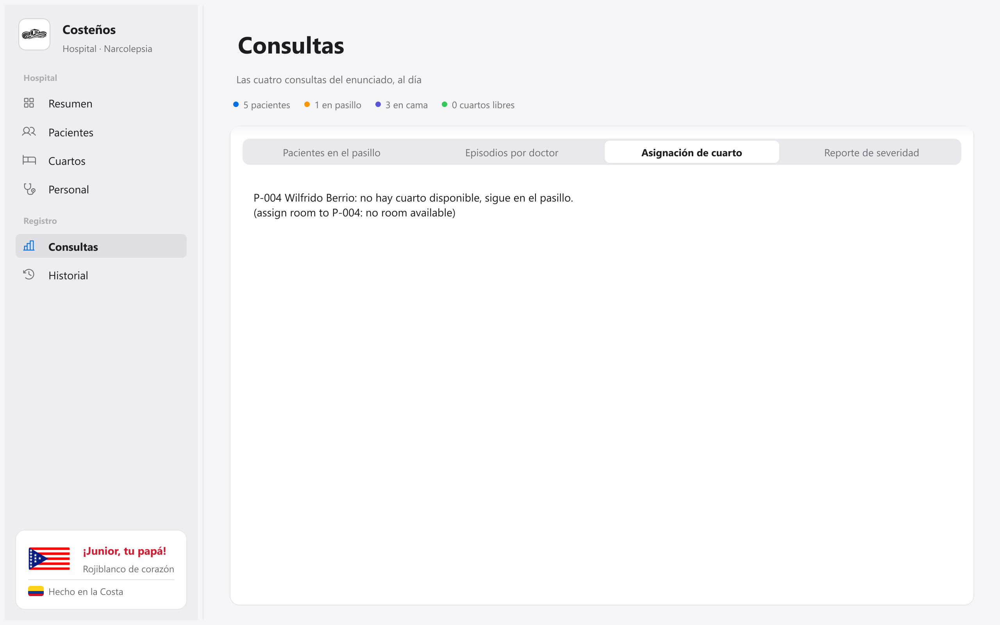<br>**Asignación de cuarto** → resultado del último `AssignRoom` | 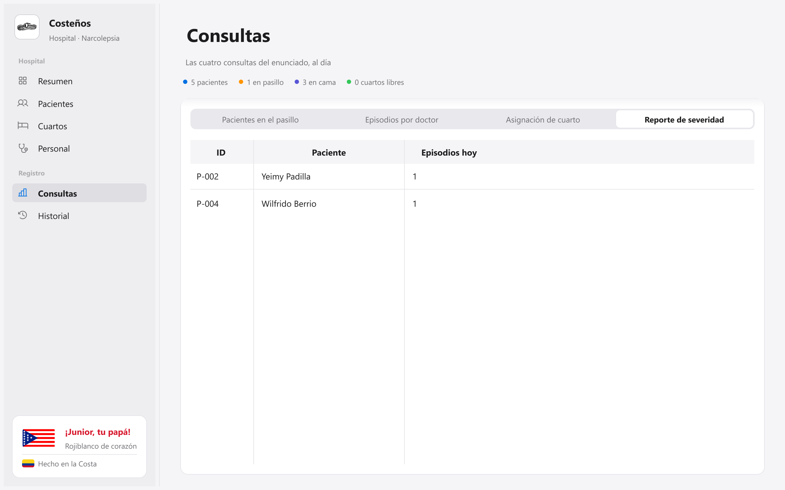<br>**Reporte de severidad** → `SevereReport()` ordenado por ID |

### Reproducir el escenario desde la GUI

1. En **Pacientes**, elige a Carlos Polo, escribe un lugar (por ejemplo `cafeteria`) y pulsa **Ataque de sueño**. Repite con P-002 y P-003.
2. Haz lo mismo con Wilfrido Berrio (P-004): aparece el aviso *"Episodio registrado, pero no hay cuarto: el paciente queda en el pasillo"*.
3. Elige a Yeimy Padilla (P-002) y pulsa **Despertar**: el cuarto 102 queda libre.
4. Vuelve a P-004 y pulsa **Asignar cuarto**: recibe el cuarto 102.
5. Revisa **Consultas** e **Historial**: coinciden con la salida de `go run .`.

### Diseño e imágenes

- Tema claro propio (`caribeTheme`) inspirado en macOS: grises neutros, un solo color de acento y colores de estado solo en puntos pequeños (verde = despierto/libre, naranja = en el pasillo, índigo = en cama/ocupado). Usa la fuente del sistema (Segoe UI en Windows) cuando la encuentra.
- Animaciones suaves al cambiar de página y notificaciones que suben desde abajo (`motion.go`).
- Detalles costeños: el **sombrero vueltiao** (ícono de la app y banner), la **bandera de Junior** con "¡Junior, tu papá!", la **bandera de Colombia** y la franja vueltiao, dibujadas píxel a píxel con `canvas.Raster`.
- Íconos de [Phosphor Icons](https://phosphoricons.com) y fotos de Wikimedia Commons, **embebidos en el binario con `embed`** (librería estándar), así que la app no necesita archivos externos.

<p align="center">
  
  &nbsp;&nbsp;&nbsp;&nbsp;
  
</p>

### Alcance

Las fotos por paciente y el reproductor de música estaban planeados en `docs/PLAN.md` como extras opcionales, pero **no se implementaron**: quedaron fuera del alcance de la entrega, y la página que los anunciaba se quitó de la interfaz.

> Las capturas de esta sección se generaron con la ventana real de la app, renderizada con el driver de pruebas de Fyne (`fyne.io/fyne/v2/test`) a escala 2×, después de provocar las cuatro crisis del escenario.

---

## 13. Tests

Hay **35 funciones de test** en `hospital/hospital_test.go` y `hospital/simulation_test.go` (varias son table-driven). Los errores se verifican con `errors.Is`.

| Grupo | Tests |
|---|---|
| **Pedidos por el enunciado** | `TestAssignRoom_FreeRoom` (hay cuarto libre), `TestAssignRoom_NoRoomAvailable` (no hay: error, el paciente sigue en el pasillo y no se crea un cuarto), `TestPatientsInHallway`, `TestMyEpisodes`, `TestSevereReport`, `TestSevereReport_OnlyToday` |
| Estados y entidades | `TestStatesString`, `TestRoomOccupySuccess`, `TestRoomOccupyFull`, `TestRoomReleaseNotInRoom`, `TestEpisodeRecordSummary` |
| Médico, camillero y polimorfismo | `TestDoctorAttendAsleepPatient`, `TestDoctorAttendAwakePatient`, `TestDoctorDiagnoseTwice`, `TestStaffAttendPolymorphism`, `TestOrderlyAttendAwakePatient`, `TestHistoryAttendedByDoctorAndOrderly` |
| Hospital | `TestHospitalAdmitPatientDuplicate`, `TestHospitalHireStaffDuplicate`, `TestHospitalAddRoomDuplicate`, `TestHospitalNilData`, `TestHospitalFindPatientNotFound`, `TestHospitalHireDoctorAndFind`, `TestHospitalGettersReturnCopies`, `TestHospitalDispatchRoundRobin`, `TestHospitalRegisterEpisode` |
| Flujo de la crisis | `TestHospitalHandleSleepAttackFillsRooms`, `TestHospitalWakeUpPatientFreesRoom`, `TestHospitalHandleSleepAttackErrors`, `TestHospitalFlowErrors`, `TestErrorCases`, `TestSameDay` |
| Concurrencia | `TestConcurrentSleepAttacks`, `TestSimulate`, `TestSimulateInvalidConfig` |

---

## 14. Decisiones de diseño

1. **Nombres en inglés.** Coinciden con las firmas del enunciado y evitan mezclar idiomas en el código. La GUI muestra los textos en español.
2. **El `Hospital` orquesta.** `HandleSleepAttack` encadena todo el flujo y `main` solo llama métodos, así que no queda lógica de negocio en `main.go`.
3. **El paciente guarda `room *Room`.** El `EpisodeRecord` copia ese cuarto al crearse (`nil` = se quedó en el pasillo), y al despertar `WakeUpPatient` sabe qué cuarto liberar sin buscarlo.
4. **`Room.Occupy` cambia al paciente con un método no exportado** (`p.moveToBed(r)`) en vez de tocar sus campos, aunque estén en el mismo paquete. Así el cuarto y el paciente siempre quedan de acuerdo. `Doctor.DiagnosePatient` usa la misma idea con `p.assignDoctor(d)`.
5. **En `EpisodeRecord`, quién atendió es de tipo `Attender`**, no `*Doctor`, porque el camillero también atiende emergencias.
6. **`Doctor.Attend` agrega el registro a `d.episodes`.** Por eso `MyEpisodes()` funciona sin recibir el hospital, como pide el enunciado.
7. **El ID del episodio lo genera quien atiende**, con su propio contador (`D-01-E1`, `O-01-E1`). No hay variables globales, que además serían un problema con concurrencia.
8. **Despacho round-robin** sobre el `[]Attender`. Es simple, determinista (el mismo escenario da siempre el mismo resultado) y no necesita saber el tipo concreto.
9. **Errores centinela** envueltos con `%w`. Quien llama los distingue con `errors.Is`, y los tests los verifican igual.
10. **`SufferSleepAttack` retorna `error`** (`ErrAlreadyAsleep`). El enunciado da firmas mínimas y pide que todo lo que pueda fallar retorne `error`.
11. **`SevereReport` incluye a los `Severe` con 0 episodios** y cuenta solo los de hoy. El map no tiene orden, así que quien imprime ordena las claves por ID.
12. **Getters que retornan copias** (`Patients()`, `Doctors()`, `Staff()`, `Rooms()`, `History()`, `FindPatient(id)`, ...). Quien llama no puede modificar el estado interno, y la GUI pudo construirse sin tocar `hospital/`.
13. **Cuando el paciente del pasillo recibe cuarto más tarde, no se crea un episodio nuevo.** `AssignRoom` solo asigna el cuarto; el episodio original queda como ocurrió (`-> hallway`).
14. **Se respeta el escenario exacto del enunciado.** Por eso el reporte de severidad da 1 episodio por paciente `Severe`; el ejemplo del PDF es solo ilustrativo.
15. **Un solo `sync.Mutex` en el `Hospital` y helpers `...Locked`.** Un lock grueso es fácil de razonar: cada operación exportada es atómica. Los helpers evitan el *deadlock* de pedir dos veces un mutex no reentrante.
16. **La interfaz es un módulo Go aparte** con `replace`. El módulo principal sigue siendo 100 % librería estándar y la GUI solo puede usar lo que `hospital` exporta.
17. **La GUI no ejecuta `Simulate`.** Leer getters mientras las goroutines modifican pacientes sería una data race; simulación e interfaz son programas separados.

---

## 15. Estrategia de Git: feature branching

### 15.1 Modelo de ramas

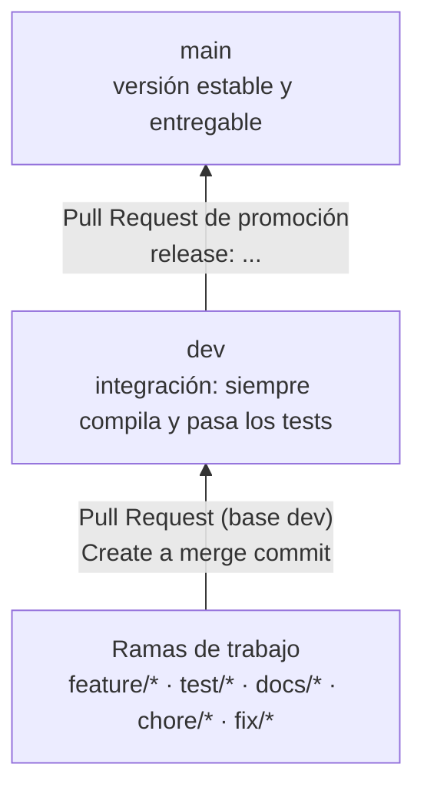

- **`main`**: versión estable. Solo recibe Pull Requests **desde `dev`** (promociones). La única excepción fue el commit inicial.
- **`dev`**: rama de integración. Recibe los Pull Requests de las ramas de trabajo y nunca recibe commits directos.
- **Ramas de trabajo**: una por unidad de trabajo, creadas desde `dev` actualizado y devueltas a `dev` por Pull Request.
- Todos los PR se integran con **"Create a merge commit"** (no squash), así que el historial conserva cada commit y muestra de qué rama vino.
- Commits con **Conventional Commits** (`feat:`, `fix:`, `test:`, `docs:`, `chore:`, `refactor:`).

| Prefijo | Uso | Ejemplo en este repo |
|---|---|---|
| `feature/` | funcionalidad nueva | `feature/sleep-attack-flow` |
| `test/` | solo tests | `test/hospital-tests` |
| `docs/` | solo documentación | `docs/readme` |
| `chore/` | setup, formato, mantenimiento | `chore/project-setup` |
| `fix/` | corrección de algo ya integrado | `fix/remove-music-page` |

### 15.2 Historial real

Estas gráficas reproducen el historial del repositorio: cada carril es una rama, cada punto un commit y cada etiqueta `#N` el Pull Request que la integró. Se dividen por etapa para que sean legibles.

**Etapa 1 — Modelo, flujo, consultas y escenario (PR #1 a #11)**

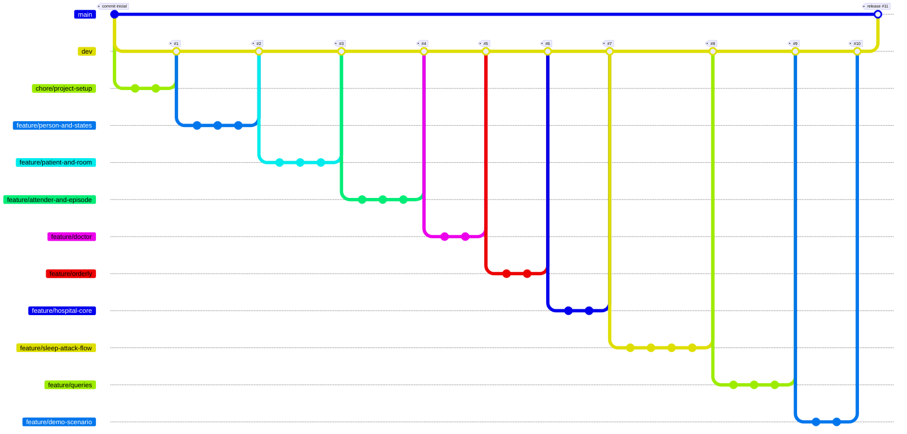

**Etapa 2 — Tests, calidad y README (PR #12 a #15)**

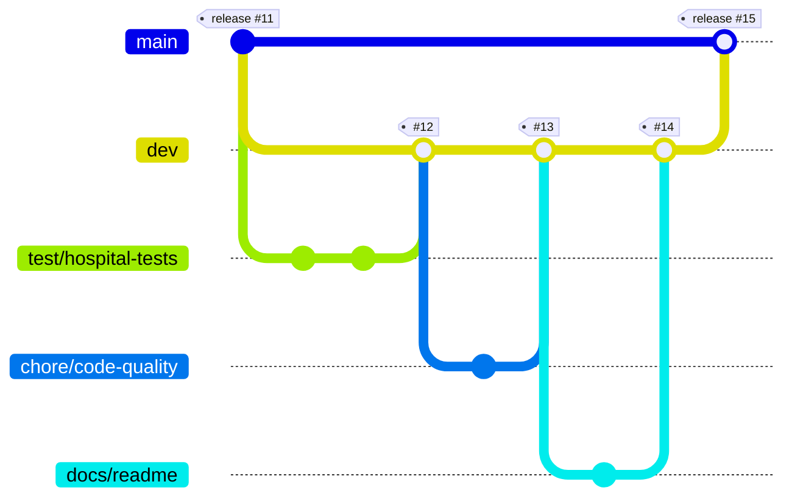

**Etapa 3 — Bonus: concurrencia e interfaz gráfica (PR #16 a #20)**

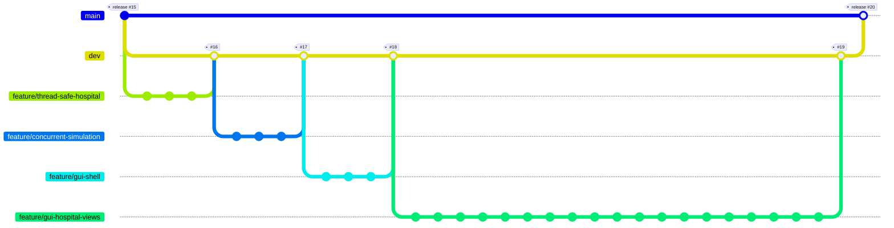

**Etapa 4 — Cierre: ajuste de la GUI, README final y promoción final**

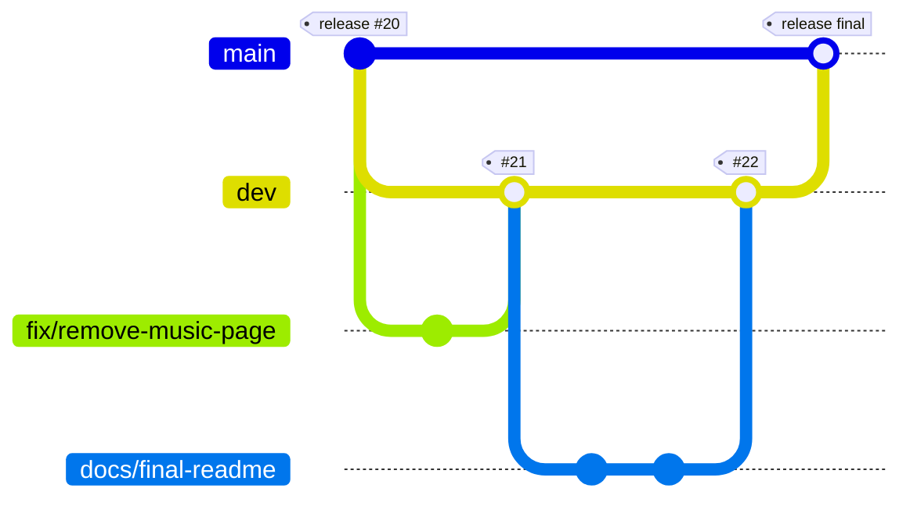

Para ver el historial completo en la terminal:

```bash
git log --oneline --graph --all
```

### 15.3 Pull Requests

| PR | Rama | Qué agregó |
|---|---|---|
| #1 | `chore/project-setup` | módulo Go, esqueleto del paquete y finales de línea LF |
| #2 | `feature/person-and-states` | `Person` y los estados tipados con `iota` + `String()` |
| #3 | `feature/patient-and-room` | `Patient` y `Room` |
| #4 | `feature/attender-and-episode` | interfaz `Attender` y `EpisodeRecord` |
| #5 | `feature/doctor` | `Doctor`, el primer `Attender` |
| #6 | `feature/orderly` | `Orderly`, el segundo `Attender` |
| #7 | `feature/hospital-core` | `Hospital`: registro, getters y búsquedas |
| #8 | `feature/sleep-attack-flow` | `AssignRoom`, despacho round-robin, `HandleSleepAttack` y `WakeUpPatient` |
| #9 | `feature/queries` | `PatientsInHallway` y `SevereReport` |
| #10 | `feature/demo-scenario` | escenario obligatorio en `main.go` |
| **#11** | `dev` → `main` | **release:** modelo, flujo, consultas y escenario |
| #12 | `test/hospital-tests` | tests pedidos, reporte de severidad y casos de error |
| #13 | `chore/code-quality` | comentario del paquete que explica el modelo |
| #14 | `docs/readme` | primer README completo |
| **#15** | `dev` → `main` | **release:** tests, calidad y README |
| #16 | `feature/thread-safe-hospital` | `sync.Mutex` y helpers `...Locked` |
| #17 | `feature/concurrent-simulation` | `Simulate` y la bandera `-sim` |
| #18 | `feature/gui-shell` | módulo `gui/` con Fyne, hospital inicial y ventana |
| #19 | `feature/gui-hospital-views` | páginas, formularios y diseño de la GUI |
| **#20** | `dev` → `main` | **release:** concurrencia, simulación y GUI |
| #21 | `fix/remove-music-page` | quita la página Música, que no estaba terminada |
| #22 | `docs/final-readme` | este README y las capturas de la GUI |
| **final** | `dev` → `main` | **release final** de la entrega |

---

## 16. Checklist del enunciado

| Punto de la sección 10 | Estado | Evidencia |
|---|:---:|---|
| Corre desde un clon limpio con `go run .` y los tests pasan con `go test ./...` | ✅ | [Inicio rápido](#3-inicio-rápido) |
| `gofmt` aplicado y `go vet` sin advertencias | ✅ | [4.6](#46-calidad-del-código-definición-de-terminado) |
| Las cinco structs existen, con campos no exportados y métodos de acceso | ✅ | [7.1](#71-entidades) |
| `Person` embebido en `Patient` y `Doctor` (y `Orderly`), sin campos duplicados | ✅ | [7.2](#72-composición-person) |
| Un `[]Attender` con al menos dos tipos concretos | ✅ | `Hospital.staff` con `*Doctor` y `*Orderly` ([7.3](#73-interfaz-attender)) |
| Estados como constantes tipadas, no strings sueltos | ✅ | `hospital/states.go` ([7.4](#74-estados-como-constantes-tipadas)) |
| Las cuatro consultas retornan datos y se llaman desde `main` | ✅ | [8](#8-las-cuatro-consultas) |
| "No hay cuarto" retorna un error y no tumba el programa | ✅ | `ErrNoRoomAvailable` ([9](#9-flujo-de-una-crisis-de-sueño)) |
| Al menos 3 tests: cuarto libre, sin cuarto y una consulta | ✅ | [13](#13-tests) |
| Bonus: simulación con goroutines y mutex, sin data races | ✅ | [11](#11-bonus-simulación-concurrente) |
| Bonus: GUI sin cambiar el paquete `hospital` | ✅ | [12](#12-bonus-interfaz-gráfica-con-fyne) y [4.7](#47-comprobar-que-la-gui-no-tocó-la-lógica) |
| `README.md` y `AI_USAGE.md` completos y honestos | 📝 | este archivo · [`AI_USAGE.md`](AI_USAGE.md) |

---

## 17. Uso de IA

El uso de IA está permitido en todo el ejercicio. Las herramientas usadas, los prompts decisivos y los casos en que el código generado estaba mal y cómo se corrigió están en [`AI_USAGE.md`](AI_USAGE.md). El plan de trabajo que guió el desarrollo con el asistente está en [`docs/PLAN.md`](docs/PLAN.md), y las reglas permanentes que siguió están en [`CLAUDE.md`](CLAUDE.md).

---

## 18. Créditos y licencias

| Recurso | Fuente | Licencia |
|---|---|---|
| Sombrero vueltiao (`gui/images/sombrero.png`) | [Wikimedia Commons](https://commons.wikimedia.org/wiki/File:Sombrero_vueltiao_stylized.svg), por Camilo Sanchez | CC BY 3.0 |
| Bandera de Junior (`gui/images/junior.png`) | [Wikimedia Commons](https://commons.wikimedia.org/wiki/File:Bandera_de_Junior_de_Barranquilla.png) | Dominio público |
| Íconos (`gui/icons/*.svg`) | [Phosphor Icons](https://phosphoricons.com) | MIT ([`gui/icons/LICENSE`](gui/icons/LICENSE)) |
| Interfaz gráfica | [Fyne](https://fyne.io) v2.8 | BSD-3-Clause |

El detalle de las imágenes está en [`gui/images/CREDITS.md`](gui/images/CREDITS.md).

<div align="center">
<sub>DUQUEJR</sub>
</div>
